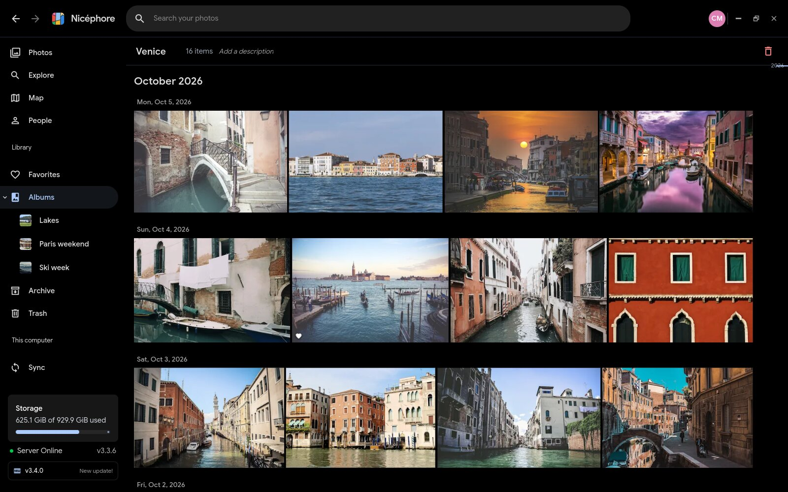
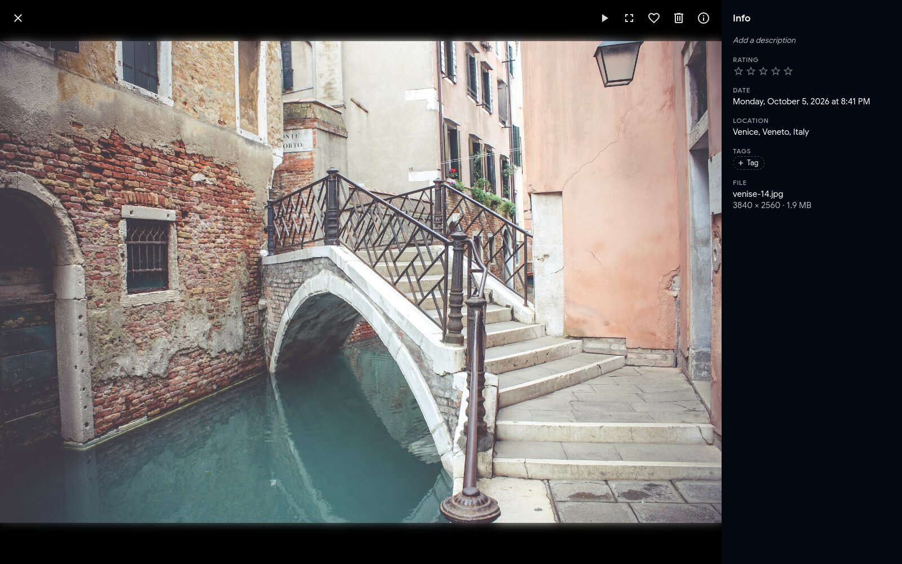
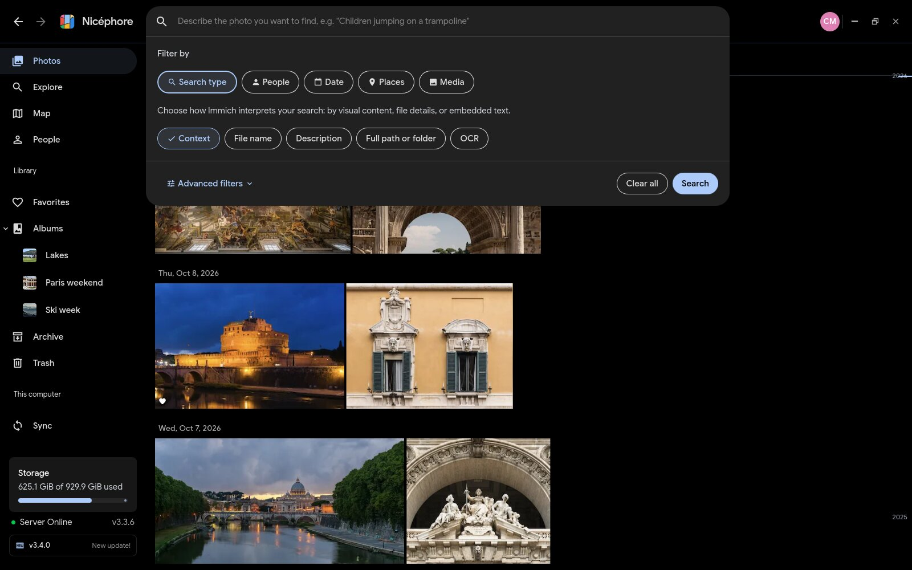
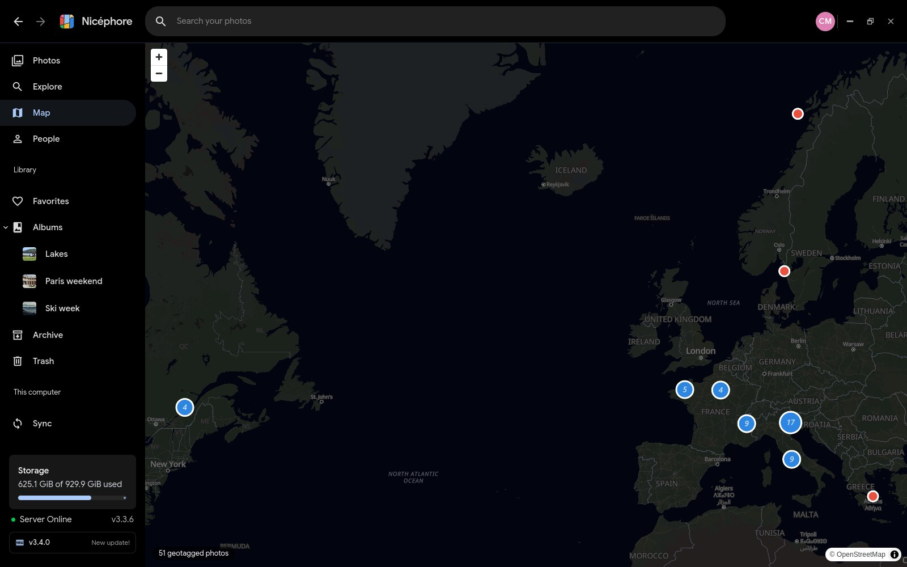
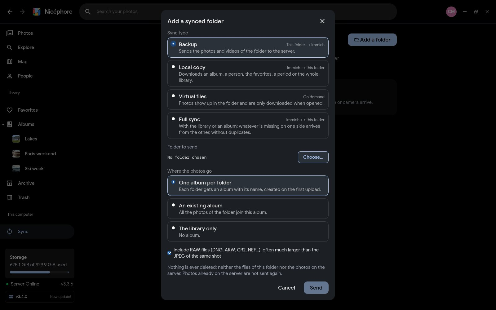

# Nicéphore

Unofficial desktop client for [Immich](https://immich.app), the self-hosted photo and video
management server, for Linux and Windows. Not affiliated with or endorsed by the Immich project.



Nicéphore brings your Immich library to the desktop: browse it like the web app, and keep the
folders of your computer in sync with it, both ways, including virtual files that are only
downloaded when you open them.

Named after Nicéphore Niépce, who took the oldest surviving photograph, a view from his window
at Le Gras (about 1827). The icon redraws that photo as a leaning De Stijl grid.

## Features

**Your library, like the web app.** Timeline with a date scrubber, albums, people (naming,
merging), map, memories, favorites, archive and trash; the viewer with its info panel, video and
slideshow; the Immich search panel with its filters (people, places, dates, camera, media);
multi-selection with bulk actions; editing of date, location, description, rating and tags.

**Sync with the folders of your computer.** Four sync types, as in the Immich mobile app:

| Type | Direction | What it does |
| --- | --- | --- |
| Backup | this folder → Immich | Sends the photos and videos of the folder, one album per folder or a chosen album. |
| Local copy | Immich → this folder | Downloads an album, a person, the favorites, a period or the whole library. |
| Virtual files | on demand | Photos show up in the folder and are only downloaded when opened. |
| Full sync | Immich ↔ this folder | Whatever is missing on one side arrives from the other, without duplicates. |

Files already on the server are recognized by their checksum and never sent twice. Nothing is
ever deleted, neither on your computer nor on the server. Sync keeps going from the tray, can
start with the session, and waits on battery or on a metered connection.

**A photo viewer for your computer.** Open any local photo or video with Nicéphore: zoom,
lossless rotation saved in the file, full screen, slideshow, a strip of the folder's photos, EXIF
details, copy to the clipboard, drag to another app, "open with", system trash with undo. It shows
whether the file is already on Immich, sends it in one click (or into an album), and opens it in
the library. A photo turned while already on Immich is turned there too, and stays the same photo
for the sync.

**And also:** several accounts and servers; the interface in French, English and 26 more
languages in full, and partly in 50 others (the texts shared with Immich); a portable mode for a
USB stick; signed in-app updates.

| | |
| --- | --- |
|  |  |
|  |  |

## Install

Download the latest version from the [releases](https://github.com/valentin-gosselin/nicephore/releases).

- **Windows 10 and 11**: the installer (`.exe`, no administrator rights needed) is the one to
  pick; it updates itself. The portable zip runs from any folder or a USB stick and keeps
  everything next to it. The executable is not signed yet, so Windows SmartScreen may warn on
  first launch: choose "More info", then "Run anyway".
- **Linux**: the AppImage runs on most distributions and updates itself; the `.deb` (Debian,
  Ubuntu, Mint...) and `.rpm` (Fedora, openSUSE...) packages install like any other package.
  Virtual files need FUSE 3 (`fuse3`), installed by the packages and present on most desktops.
- **macOS**: not available yet. Contributions are welcome.

Nicéphore needs an Immich server (tested with v3.x). It signs in like the web app and keeps
only the session token, in the system keyring (or sealed by a passphrase in portable mode).

Machine translations: beyond French and English, the texts specific to Nicéphore are machine
translated in 26 languages; corrections are welcome. The texts Nicéphore shares with Immich come
from the Immich community on [Weblate](https://hosted.weblate.org/projects/immich/) and are
refreshed with each release.

## Layout

- `crates/api_immich`: typed client for the Immich API (session or API key authentication).
- `crates/cache_vignettes`: on-disk image cache shared by the UI.
- `crates/envoi`: sync engine (SQLite queue, folder watching, checksum pre-check, retries).
- `crates/virtuel`: virtual files (FUSE on Linux, Cloud Files API on Windows).
- `app/`: Tauri 2 shell (`src-tauri/`) and Svelte 5 UI built with `@immich/ui`.
- `docs/`: design notes and per-milestone reports (French).

## Development

Linux build dependencies (Fedora): `webkit2gtk4.1-devel gtk3-devel libsoup3-devel
javascriptcoregtk4.1-devel librsvg2-devel libappindicator-gtk3-devel openssl-devel`, plus Rust and
Node.js.

```sh
cd app
npm install
npx tauri dev          # development
npx tauri build        # release
```

For development, `IMMICH_URL` and `IMMICH_API_KEY` connect the app at startup
(`scripts/lancer.sh --dev` reads them from `~/.config/nicephore/dev.env`).

Interface texts are written in French, which serves as the key: `en.json` holds the English, and
`npm run traductions` (in `app/`) pulls the Immich community translations of the shared texts.

Testing:

- `cargo test --workspace`: unit tests.
- `scripts/immich-jetable.sh demarrer|tester|arreter`: a disposable Immich server in Docker
  (local only, generated photos) and the write tests of the API client and sync engine against
  it. Write tests never target a real library.
- `scripts/banc.sh`: read-only benchmark in an invisible virtual KWin session (scrolling frame
  times, thumbnail fill rate, screenshots); `--jetable` drives the real interface through a write
  scenario against the disposable server; `--fichier` the local viewer; `--portable` portable
  mode over two launches; `scripts/essai-mise-a-jour.sh --construire` tests an in-app update end
  to end with a throwaway signing key.
- `scripts/vitrine.sh demarrer|captures`: the showcase server and the screenshots of this page.

Releases are built by GitHub Actions on `v*` tags (`.github/workflows/publication.yml`), as a
draft. Each tag needs its notes in `docs/versions/<tag>.md`: the first paragraph, in plain text, is
shown by the in-app updater, and the whole file becomes the release page.

## Credits

The photos in the screenshots are in the public domain (CC0), from Wikimedia Commons; their
sources and authors are listed in [`tests/vitrine/photos.json`](tests/vitrine/photos.json).
Interface font: Google Sans (SIL Open Font License). Interface components: `@immich/ui`.

## License

AGPL-3.0-or-later. See [LICENSE](LICENSE).
