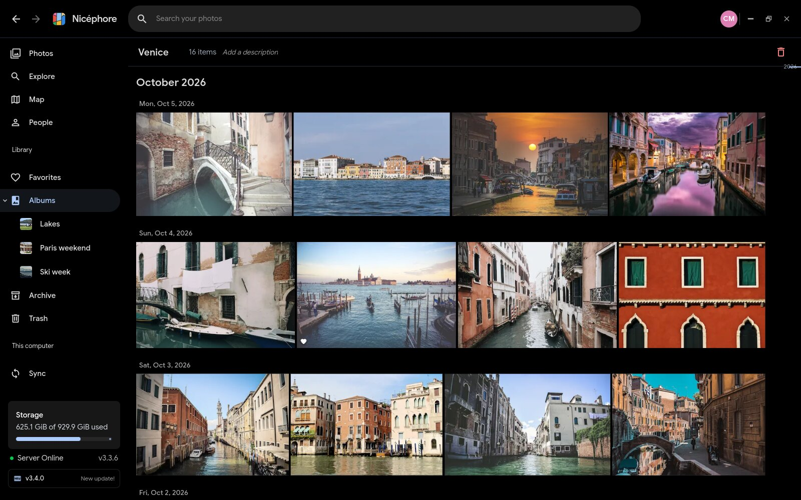

First public release of Nicéphore, an unofficial desktop client for Immich, for Windows and Linux.

<!-- release page -->

## Highlights

- **Your library, like the web app**: timeline, albums, people, map, memories, favorites, archive and trash; the viewer with its info panel, video and slideshow; the Immich search panel and its filters; bulk actions and metadata editing.
- **Sync with the folders of your computer**, with the four types of the Immich mobile app: backup, local copy, virtual files (downloaded only when opened) and full two-way sync. Files already on the server are recognized by their checksum, and nothing is ever deleted.
- **A photo viewer for local files**, which tells whether a photo is already on Immich and sends it in one click.
- Several accounts and servers, a portable mode, signed in-app updates, and the interface in French, English and 26 more languages.

## Download

| System | File |
| --- | --- |
| Windows 10 and 11 | `Nicephore_0.1.0_x64-setup.exe` (recommended, updates itself) or `Nicephore_v0.1.0_portable_x64.zip` |
| Linux, any distribution | `Nicephore_0.1.0_amd64.AppImage` (updates itself) |
| Debian, Ubuntu, Mint | `Nicephore_0.1.0_amd64.deb` |
| Fedora, openSUSE | `Nicephore-0.1.0-1.x86_64.rpm` |

The `.sig` files and `latest.json` are used by the in-app updater; you do not need them.

## Good to know

- Nicéphore needs an Immich server (tested with v3.x).
- The Windows executable is not code-signed yet: SmartScreen may warn on first launch ("More info", then "Run anyway").
- Virtual files on Linux need FUSE 3 (`fuse3`), installed with the packages.
- macOS is not available yet.
- Beyond French and English, the texts specific to Nicéphore are machine translated; corrections are welcome.

This is a first version: please report bugs and ideas in the [issues](https://github.com/valentin-gosselin/nicephore/issues).
